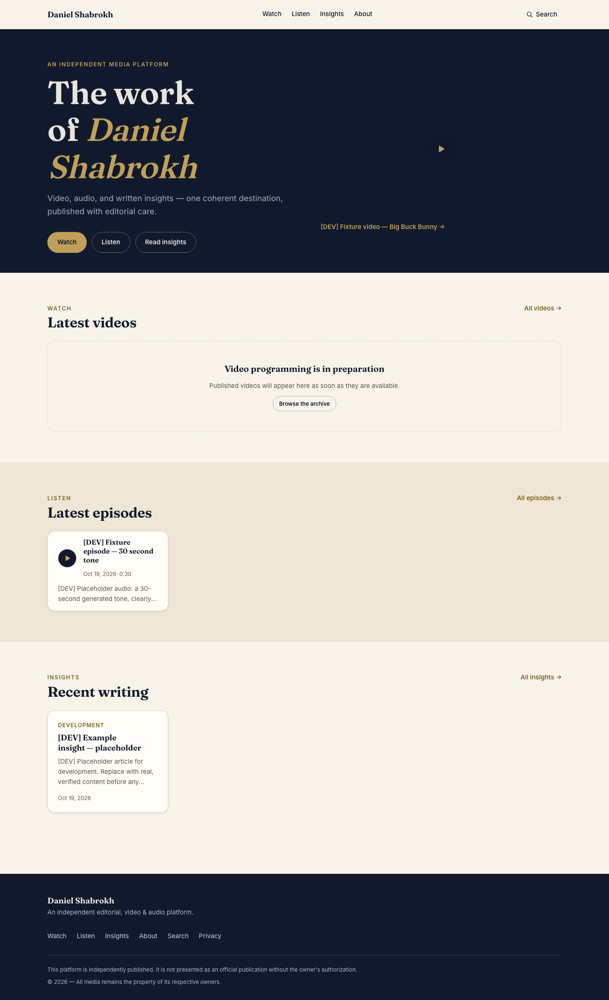
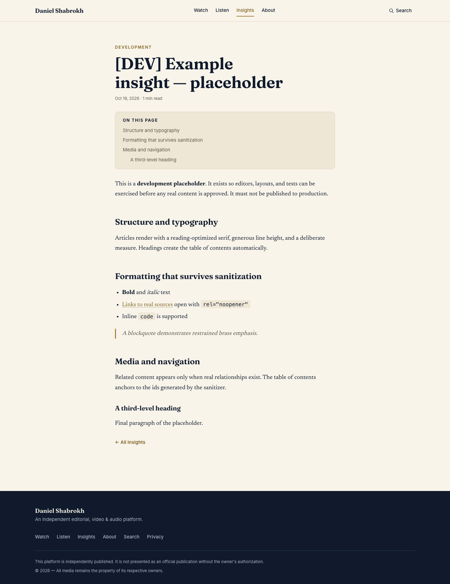
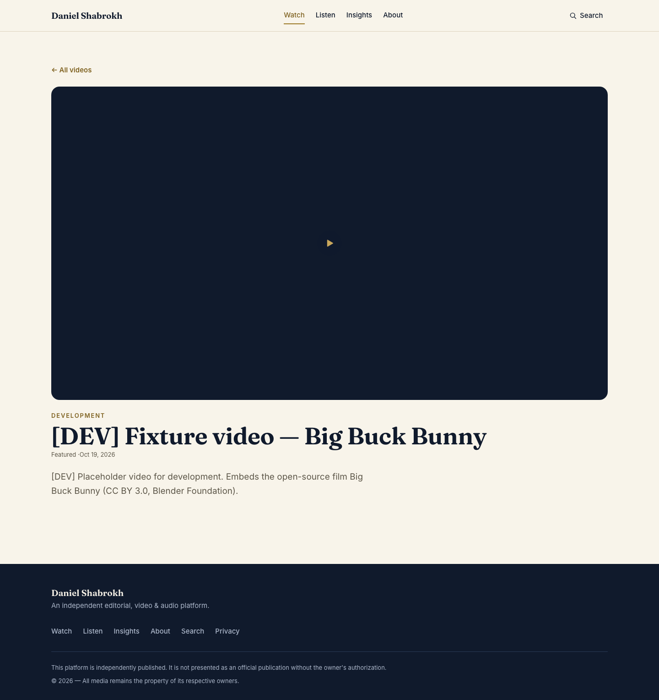
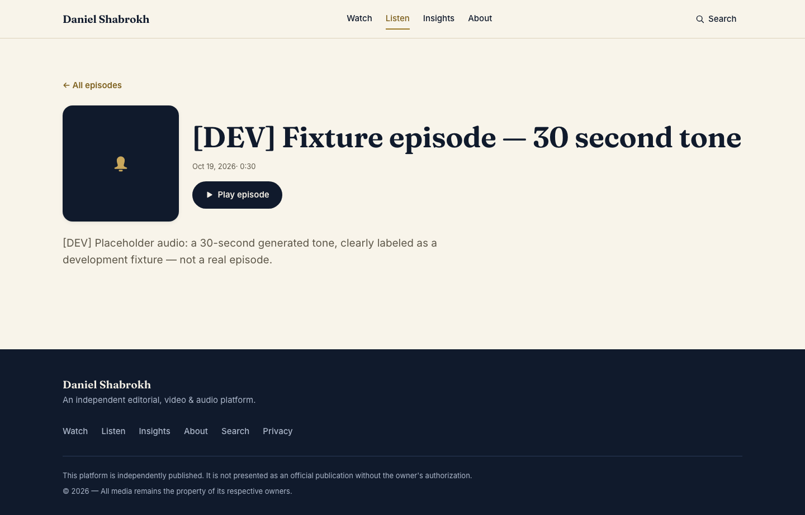
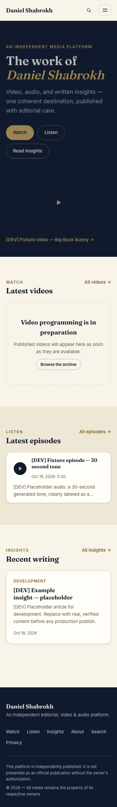
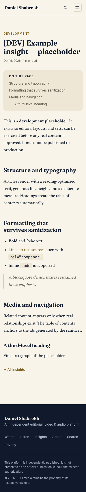
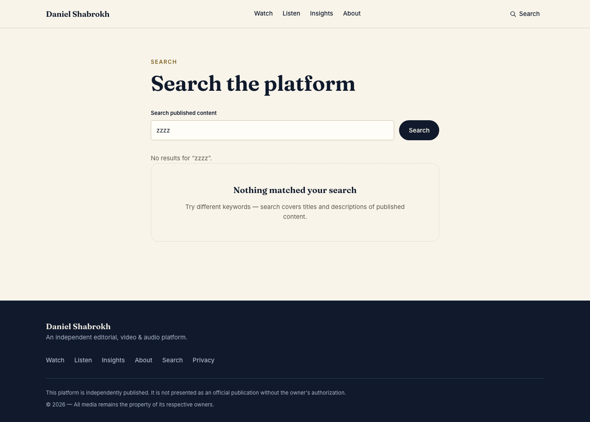
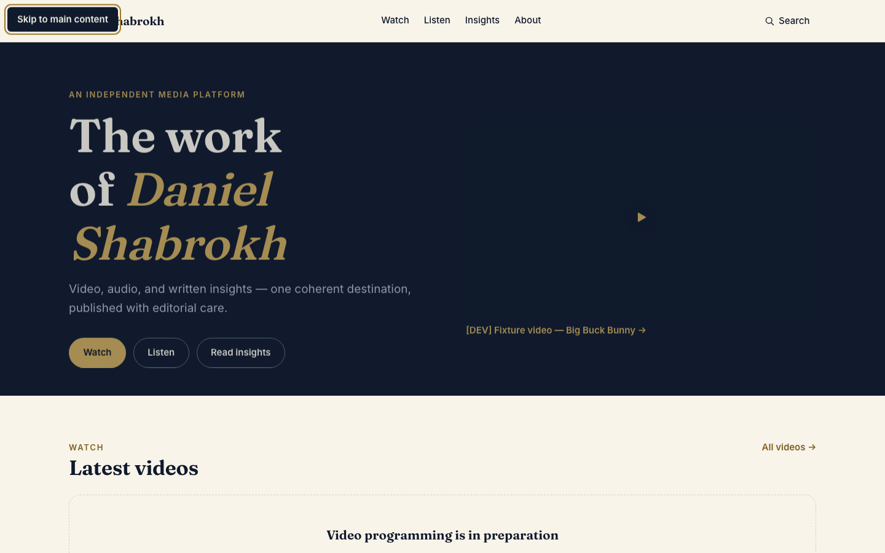
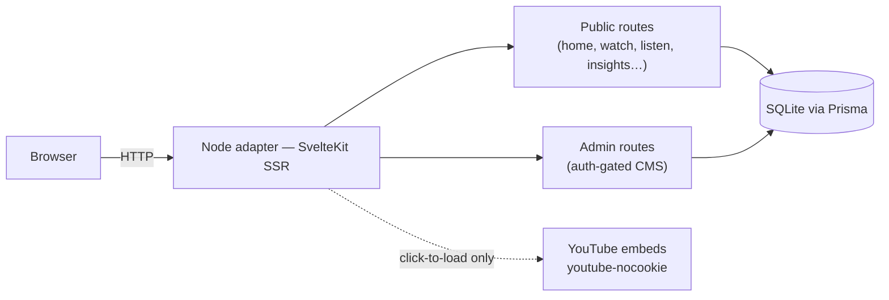

# DSH — Daniel Shabrokh Podcast Website

An independent, editorial-quality website concept for the **Daniel Shabrokh
podcast**: one coherent destination for video, audio, and written insights,
backed by a private single-administrator publishing panel.

> **Status — read this first.** This is an **independent proposal**. It is not
> an official website and has no affiliation with, endorsement from, or
> authorization by Daniel Shabrokh. All content in the screenshots and seed
> data below is clearly labeled `[DEV]` placeholder material awaiting
> owner-verified replacement. The site has **not been deployed publicly**.
> Current verification state: [docs/RELEASE_STATUS.md](docs/RELEASE_STATUS.md).

## The problem

A podcast's material ends up scattered: long episodes live on YouTube, clips
and short posts live elsewhere, and written ideas have no home at all. A
listener who wants to *understand the programme* — watch, listen, and read
around it — has no single destination, and the hosts have no way to publish
editorial material without a developer.

## The solution

One self-contained digital home that presents the programme's identity,
video archive, audio, and editorial writing with genuine editorial craft —
while YouTube remains where playback actually happens (privacy-preserving
`youtube-nocookie` embeds, loaded only on click) — plus a secure
single-administrator CMS so real content can be managed end to end without
touching code: drafts, preview, publish, unpublish, archive, delete.

## Visual tour

Every image below is a **real capture of the running production build**
(1440×900 desktop, 390×844 mobile) with `[DEV]` fixture content. The E2E
suite regenerates a 20-shot evidence set on every run in
[`tests/screenshots/`](tests/screenshots/).

| | |
| --- | --- |
|  |  |
| *Home — ink hero, brass accent, click-to-load featured video* | *Insights article — serif reading column with table of contents* |
|  |  |
| *Watch detail — facade until the visitor plays* | *Listen detail — persistent shared player* |

| | |
| --- | --- |
|  |  |
| *Mobile home at 390px* | *Mobile article — no overflow at phone width* |
|  |  |
| *Search with no matches — a real, deliberate empty state* | *Visible keyboard focus (skip link)* |

More states — [404](docs/screenshots/states/error-404.png),
[open player](docs/screenshots/states/player.png),
[mobile navigation](docs/screenshots/mobile/nav-open.png),
[admin sign-in](docs/screenshots/states/admin-login.png), and the
[content editor](docs/screenshots/states/admin-editor.png) — are in
[`docs/screenshots/`](docs/screenshots/).

## Features

**Implemented and test-verified**

- **Public site**: home with hero + three content sections; Watch archive +
  video detail; Listen archive + episode detail with a *single shared audio
  player that persists across client-side navigation*; Insights archive +
  article pages (sanitized Markdown, table of contents, reading time); About
  with honest "pending verification" states (no invented biography); Search
  across published content only; Privacy; deliberate 404/error/empty
  states; sitemap/robots generated from published content; canonical +
  Open Graph metadata.
- **Publishing panel** (`/admin`): dashboard with real counts; per-type
  lists with search/filter; create/edit/save-draft/preview/publish/
  unpublish/archive/restore/delete (no-JS confirmation for destructive
  actions); server-side validation incl. duplicate-slug rejection; a draft
  preview route that never exposes content publicly; an audit log.
- **Security**: argon2id hashing; opaque session tokens stored only as
  SHA-256 hashes; HttpOnly/SameSite=Lax/Secure-on-HTTPS cookies; sliding
  expiry with a hard cap; login rate limiting; generic errors with timing
  equalization; forced first-password change; password rotation invalidates
  other sessions; CSRF origin checks; strict CSP; security headers.

**Planned / owner-gated (explicitly not built)**

Public registration, multi-role permissions, comments/social, payments,
custom video hosting, analytics, email flows — all deliberately out of
scope. Real biography, official links, episode data, and an `og:image`
require owner verification first.

## Architecture



```
prisma/schema.prisma        data model (Administrator, Session, Article, Video, AudioEpisode, AdminEvent)
src/routes/                 public pages, /admin (CMS), /preview (draft preview), /healthz
src/lib/server/             auth, guard, CMS services, content queries, validation, Markdown sanitizer, audit
src/lib/components/         header, footer, cards, YouTube facade, shared audio player
src/lib/styles/             design tokens (WCAG-contrast-verified) + global styles
scripts/                    admin init, [DEV] seeding, E2E preparation, audio fixture,
                            web-vitals measurement
tests/                      unit (vitest), e2e (Playwright), screenshot evidence
docs/                       brief & history, release status, screenshots
```

## Technology stack

[SvelteKit 3](https://svelte.dev/docs/kit) + Svelte 5 (runes) + TypeScript ·
[Prisma 7](https://www.prisma.io) + SQLite (better-sqlite3) for
single-instance deployments ·
[@node-rs/argon2](https://github.com/napi-rs/node-rs/tree/main/crates/argon2)
· Vitest + Playwright + axe-core · self-hosted variable fonts (Fraunces,
Newsreader, Inter). `pnpm.overrides` pins `lodash ≥ 4.18` (the only audit
findings ever found lived in Prisma Studio's bundled UI tooling); `pnpm
audit` reports zero known vulnerabilities.

## Getting started

Requires Node ≥ 20 (developed on 26) and pnpm ≥ 9.

```sh
pnpm install
cp .env.example .env          # then edit DATABASE_URL (see Configuration)
pnpm exec prisma migrate dev  # create/apply the schema
pnpm admin:create -- --username <your-name>   # prints a one-time temporary password
pnpm dev                      # http://localhost:5173
```

Sign in at `/admin/login` — you are forced to set a permanent password
before anything else. To explore the UI with labeled placeholder content:

```sh
pnpm db:seed-dev   # [DEV] fixtures; refuses to run with NODE_ENV=production
```

## Configuration

All variables have safe placeholders in [`.env.example`](.env.example):

| Variable | Purpose |
| --- | --- |
| `DATABASE_URL` | SQLite URL — **absolute path** (`file:/srv/dsh/app.db`): the Prisma CLI and the runtime resolve relative paths differently. |
| `SITE_BASE_URL` | Canonical origin for canonical/OG/robots/sitemap; empty falls back to the request origin. |
| `KIT_ORIGIN` | Build-time origin for direct-to-Node production builds; leave unset behind a proxy (which should send `PROTOCOL_HEADER`/`HOST_HEADER`). |

No session secret exists (tokens are random and stored hashed). Missing
required configuration fails at startup with a clear error. Never commit
`.env`.

## Testing and quality assurance

| Command | Result (2026-10-19) |
| --- | --- |
| `pnpm check` | 0 errors, 0 warnings (svelte-check) |
| `pnpm test` | **34/34 passed** — validation, Markdown sanitization, WCAG contrast of every design-token pair |
| `pnpm test:e2e` | **38/38 passed** — fresh production build, real server: auth lifecycle, CMS draft→publish→unpublish→delete, draft privacy, search, audio playback + keyboard controls + cross-navigation persistence, YouTube click-to-load, XSS end-to-end probe, responsive matrix 320–1440px, axe-core (0 serious/critical), layout integrity |

E2E credentials are generated per run; the suite uses an isolated database
and never touches real data. `GET /healthz` answers a real database query —
use it for post-deploy smoke checks.

## Build and production verification

```sh
KIT_ORIGIN=https://your.domain pnpm build   # or omit behind a proxy
pnpm exec prisma migrate deploy             # apply migrations first
DATABASE_URL=file:/srv/dsh/app.db NODE_ENV=production PORT=3000 node build/index.js
```

Proxy checklist: terminate TLS, add HSTS at the proxy, forward
`x-forwarded-proto`/`x-forwarded-host`. Backup is one SQLite file:
`sqlite3 app.db ".backup 'backup.db'"`. **No production deployment has been
performed.** Lab-measured Core Web Vitals on the production build: LCP
148–2124ms, CLS ≤ 0.004, interaction latency ≤ 136ms (localhost laboratory
numbers — no field data exists).

## Content and media provenance

All seeded content is `[DEV]`-labeled: the video fixture is Big Buck Bunny
(CC BY, Blender Foundation), the audio fixture is a generated 30-second
tone, and the seeder refuses to run in production. Video is embedded only
via YouTube's official privacy-enhanced player; nothing is scraped or
re-hosted. Real biography, official links, episode data, images, and
publication rights all require owner verification before any publish —
see [docs/PROJECT_BRIEF_AND_HISTORY.md](docs/PROJECT_BRIEF_AND_HISTORY.md).

## Accessibility, security, and privacy

- **Accessibility (tested, not declared):** axe-core scans across 14 pages
  with zero serious/critical violations; WCAG contrast of every
  design-token pair verified by unit test; keyboard journeys (skip link,
  player controls, admin forms) exercised in E2E; visible focus states;
  reduced-motion support; 320–1440px overflow matrix clean.
- **Security:** listed under Features; residual risks documented honestly —
  single-instance SQLite, HSTS delegated to the proxy, ASCII-only search
  case-folding.
- **Privacy:** no analytics, no third-party tracking, no third-party JS
  before a video is played; the privacy page describes actual behavior.

## Known limitations and release status

An independent visual review of the archived screenshots is still pending.
Remaining release gates: owner content + publication authorization, a
deployment destination, and field performance data. Nothing in this
repository implies owner permission or production readiness. Details:
[docs/RELEASE_STATUS.md](docs/RELEASE_STATUS.md).

## Roadmap (owner-gated, not shipped)

1. Owner-verified content and authorization → replace all `[DEV]` fixtures
   via the CMS.
2. Independent visual review pass over the archived screenshots →
   triage → fixes.
3. Production deployment once the owner designates a host/domain.
4. Field Core Web Vitals collection.

## Maintenance

Update dependencies with `pnpm install` after pulling; apply migrations
with `pnpm exec prisma migrate deploy`; add content only through the CMS.
Regenerate the screenshot evidence set with `pnpm test:e2e`.

## License and contact

**No license is granted.** This repository carries no license file; all
rights are reserved by default, and nothing here may be reused, adapted, or
redistributed without explicit written permission. The project is presented
as an independent proposal to the podcast owner. No contact channel is
published pending owner-verified details.
